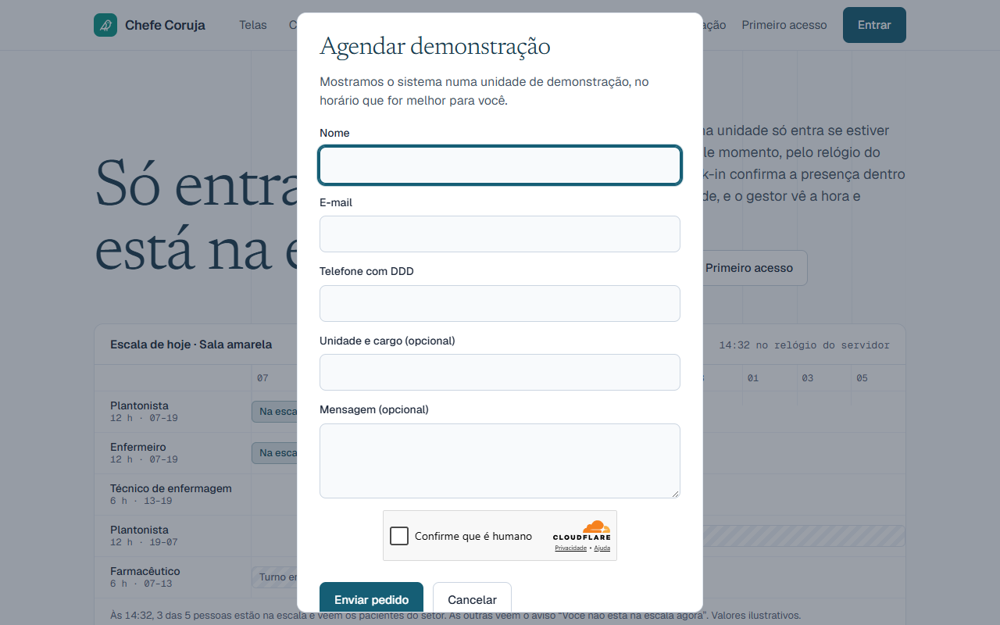
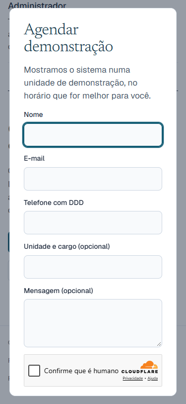

# J3: evidência do formulário "Agendar demonstração"

Pedido 8, caminho C, J3, com as decisões F1–F3 do RT de 12/11/2026 (`docs/landing/J3-FORMULARIO-DEMONSTRACAO-DIAGNOSTICO.md`). Entregue pelo #633, mesclado em 12/11/2026 (233cb98e).

## Homologação

- Migration `20270406000001_pedido_demonstracao_limite.sql` aplicada pelo `db push`, com só ela pendente. O teste `supabase/tests/j3_pedido_demonstracao_limite.sql` deu certo, e o rollback foi testado em transação desfeita.
- Função `pedir-demonstracao` publicada. Isca 200, dado inválido 400, token falso 403.
- O primeiro envio do RT pela tela deu 502. O log mostrou a Resend recusando o remetente (`HTTP 422 validation_error Invalid 'from' field`): o `EMAIL_FROM` da homologação está fora do formato. A função passou a usar remetente próprio, `Site Chefe Coruja <nao-responda@chefecoruja.com.br>`, o mesmo do formulário da `landing/`.
- Segundo envio do RT, com Turnstile: a tela mostrou "Pedido enviado." e o e-mail "Pedido de demonstração: <nome>" chegou ao Gmail do contato, enviado por `nao-responda@chefecoruja.com.br`, com nome, e-mail, telefone, unidade e mensagem.

## Produção

Com o "ok produção" do RT de 12/11/2026:

- Migration aplicada pelo SQL em uma transação e registrada em `supabase_migrations.schema_migrations` com a versão `20270406000001`. Era a mais nova; a anterior na produção é a `20270405000006`.
- Conferido depois: a tabela `private.pedido_demonstracao_limite` tem RLS ligado; `anon` e `authenticated` não executam `public.contar_pedido_demonstracao(text)` nem leem a tabela; só o `service_role` executa; `search_path` vazio.
- Função `pedir-demonstracao` publicada (`--use-api`). O RT cadastrou o `TURNSTILE_SECRET` no projeto de produção.

| Chamada | Resposta |
|---|---|
| campo-isca preenchido | 200 |
| nome curto | 400, campo `nome` |
| token falso, antes do `TURNSTILE_SECRET` | 503 "envio indisponível" |
| token falso, depois do `TURNSTILE_SECRET` | 403 "confirme que você não é um robô" |
| `OPTIONS` com origem www | `Access-Control-Allow-Origin: https://www.chefecoruja.com.br` |

## Tela no ar

Conferido em www.chefecoruja.com.br, num Edge sem janela, logo depois da publicação do Vercel:

- dois botões "Agendar demonstração": no topo e no fim da página;
- o botão abre a janela centralizada, com o foco no nome e o Turnstile carregado;
- em 375 px a janela cabe na largura.

## Fica para o RT

- Um envio real pelo site da produção, para confirmar o e-mail de ponta a ponta.
- O `EMAIL_FROM` da homologação está fora do formato. O envio do código de 2FA usa esse segredo; na homologação ele provavelmente falha. A produção não foi conferida.
